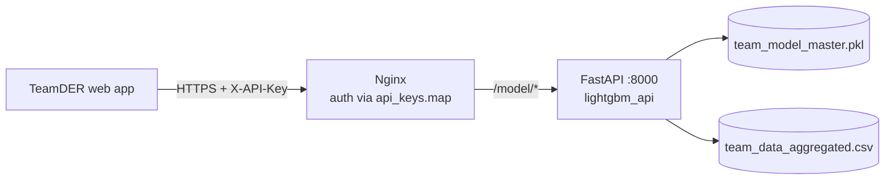

# TeamDER — AI Service

**A private machine-learning API that predicts how well a group of people will work together on a given project.**

This repository contains the back-end service for [TeamDER](https://github.com/tanakorn104/teamder): a FastAPI application serving a multi-output LightGBM model, deployed with Docker behind an Nginx reverse proxy that enforces API-key authentication.

> Built by **TeamDER** for the **KU AI Pioneers: Forward Challenge** (Kasetsart University).

---

## What it does

Given a project (tags and type) and a list of prospective members (personality, decision-making style and skill), the service predicts four team outcomes and combines them into one **match percentage** that the web app shows to students.

| Target | Meaning |
| --- | --- |
| `Y1_Safety` | Psychological safety inside the team |
| `Y2_Compatibility` | Member compatibility and team chemistry |
| `Y3_Success` | Likelihood of delivering the work (responsibility, "carry" factor) |
| `Y4_Innovation` | Capacity for creative output |

**Overall match percent** is a weighted average:

```
overall = 0.40 * Success + 0.30 * Compatibility + 0.20 * Safety + 0.10 * Innovation
```

## Architecture



- **Nginx** is the only public entry point. Requests to `/model/` without a valid `X-API-Key` get `401`. The key-to-client mapping is read from `nginx/api_keys.map` (not committed).
- The **API container** exposes no port to the outside; it is reachable only through the shared Docker network.
- Interactive docs (`/docs`, `/redoc`, `/openapi.json`) are disabled on purpose.

## The model

- **Type:** `MultiOutputRegressor` around `LGBMRegressor` (LightGBM), predicting the four targets at once
- **Team-level learning:** individual data is aggregated to one row per team (mean of each trait, plus `Max_Skill` to capture the influence of a standout member)
- **Project context:** project type (`education`, `professional`, `competition`, `hobby`) and an 8-dimension vector derived from the project tags
- **Training data:** 10,000 team-level rows with 20 input features and 4 targets, spread evenly across the four project types and team sizes 2–5
- **Online learning:** feedback is appended to the dataset and the model is retrained in the background every 10 new cases, without blocking the API

### Input features (20)

| Group | Features |
| --- | --- |
| Context | `Env_Type`, `Tag_Dim_1` … `Tag_Dim_8` |
| Team | `TeamSize` (2–5) |
| Personality (Big Five means) | `BFI_O_Mean`, `BFI_C_Mean`, `BFI_E_Mean`, `BFI_A_Mean`, `BFI_N_Mean` |
| Decision-making (SJT means) | `SJT_Lead_Mean`, `SJT_Plan_Mean`, `SJT_Support_Mean` |
| Skill | `Skill_Mean`, `Max_Skill` |

## API

All routes are served through Nginx under the `/model/` prefix, e.g. `POST /model/predict`.
All trait values are floats in `[0, 1]`.

### `POST /predict`

```json
{
  "project_cfg": {
    "tags": ["machine learning", "startup", "pitching"],
    "env_type": "competition"
  },
  "members": [
    { "O": 0.85, "C": 0.90, "E": 0.75, "A": 0.80, "N": 0.20,
      "Lead": 0.85, "Plan": 0.90, "Support": 0.85, "Skill": 0.95 },
    { "O": 0.70, "C": 0.85, "E": 0.60, "A": 0.90, "N": 0.30,
      "Lead": 0.40, "Plan": 0.80, "Support": 0.95, "Skill": 0.75 }
  ]
}
```

Response (example values):

```json
{
  "status": "success",
  "overall_match_percent": 86.45,
  "predictions_detail": {
    "Y1_Safety": 78.50,
    "Y2_Compatibility": 82.20,
    "Y3_Success": 92.15,
    "Y4_Innovation": 75.30
  }
}
```

### `POST /feedback`

Send the real outcome of a team back to the system. Same body as `/predict` plus `actual_scores`, ordered as `[Safety, Compatibility, Success, Innovation]`, each in `[0, 1]`:

```json
{
  "project_cfg": { "tags": ["machine learning"], "env_type": "competition" },
  "members": [ { "O": 0.85, "C": 0.90, "E": 0.75, "A": 0.80, "N": 0.20,
                 "Lead": 0.85, "Plan": 0.90, "Support": 0.85, "Skill": 0.95 } ],
  "actual_scores": [0.80, 0.85, 0.95, 0.80]
}
```

Response: `{ "status": "success", "progress": "3/10" }` (progress toward the next retraining batch).

Example call through the proxy:

```bash
curl -X POST http://localhost/model/predict \
  -H "Content-Type: application/json" \
  -H "X-API-Key: <your-key>" \
  -d @request.json
```

## Tech stack

Python 3.11 · FastAPI · Uvicorn · Pydantic · LightGBM · scikit-learn · pandas · NumPy · joblib · Docker Compose · Nginx

## Repository layout

```
.
├── docker-compose.yml        # Nginx + AI API (shared external network)
├── nginx/
│   ├── default.conf          # Proxy rules + API-key check
│   └── api_keys.map          # key -> client name (NOT committed)
└── pythonAIAPI2.0/
    ├── main.py               # FastAPI app, feature extraction, retraining task
    ├── Dockerfile
    ├── docker-compose.yml    # Standalone run of the API only
    ├── requirements.txt
    ├── team_data_aggregated.csv
    └── team_model_master.pkl
```

## Getting started

### Option A — Full stack with Docker (Nginx + API)

1. Create the shared network once:

   ```bash
   docker network create main_shared_network
   ```

2. Create `nginx/api_keys.map` with one line per client (`"<key>" "<client-name>";`). Generate a strong random key, for example:

   ```bash
   openssl rand -hex 32
   ```

   See `nginx/api_keys.map.example` for the format.

3. Start everything:

   ```bash
   docker compose up --build
   ```

   Nginx listens on port `80` of the host.

### Option B — API only, for local development

```bash
cd pythonAIAPI2.0
docker compose up --build        # http://localhost:8000
# or, without Docker:
pip install -r requirements.txt
uvicorn main:app --host 0.0.0.0 --port 8000 --reload
```

In this mode there is no Nginx authentication layer, so do not expose the port publicly.

### Connecting the web app

Set these in the web app's environment:

```
TeamderNginxServiceURI=http://<host>
lightGBM_X_API_KEY=<a key from api_keys.map>
```

## Security notes

- Keep `.env` and `nginx/api_keys.map` out of version control (they are in `.gitignore`).
- If a secret was ever committed, rotate it, since deleting the file does not remove it from git history.
- `--reload` in the Dockerfile is meant for development; remove it for production.

## Limitations and roadmap

- Tag vectors come from a lightweight hash-based projection, not a trained text embedding; replacing them with sentence embeddings would give real semantic similarity between project topics.
- Predictions are probabilistic recommendations, not guarantees; self-reported questionnaires may not capture real behaviour, which is why the web app blends in peer evaluations.
- Add automated tests, model versioning and evaluation reports (R², per-target error).
- Move retraining out of the request process (job queue or scheduled worker).

## Related

- Web app: [`tanakorn104/teamder`](https://github.com/tanakorn104/teamder)

## Team

**TeamDER** — Thanakorn Phromlek (Team Leader), Thanakrit Wanmee, Natthinan Chula, Phangphuai Lungjing

## License

No license has been specified yet.
